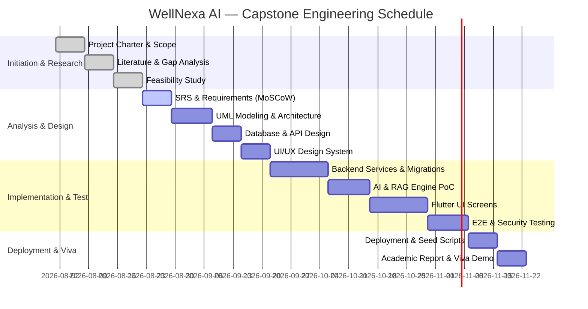

# WellNexa AI — Schedule Feasibility & Milestone Plan

## Schedule Feasibility Verdict
**FEASIBLE**: The structured 20-phase engineering lifecycle fits comfortably within a standard academic semester timeframe.
