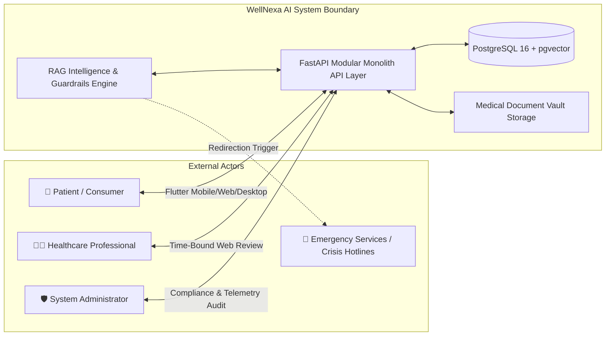

# WellNexa AI — Actor Analysis & System Boundaries

### Primary Actors
1. **Patient (User)**: Authenticated individual with full sovereign ownership over their profile, documents, vitals, prescriptions, and sharing permissions.
2. **Healthcare Professional (Doctor)**: Authenticated clinician or holder of a valid time-bound token granted temporary read access to structured summaries and consultation note recording.
3. **System Administrator**: Compliance officer with elevated privileges to inspect audit logs and monitor server health without access to unencrypted patient clinical records.
