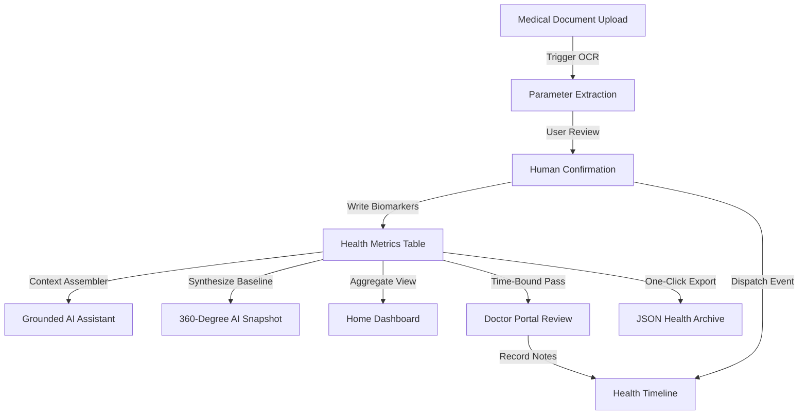

# WellNexa AI — Multi-Module Integration Verification

### Verified Integration Pipelines
1. **Report to Timeline Pipeline**: Uploading a PDF report extracts biomarkers $\rightarrow$ Patient confirmation writes to `health_metrics` $\rightarrow$ Automatic event dispatched to `health_timeline_events`.
2. **Prescription to Adherence Pipeline**: Prescriptions generate daily schedules $\rightarrow$ Dose logging decrements inventory $\rightarrow$ Adherence engine computes 30-day percentage tier $\rightarrow$ Result rendered on Home Dashboard.
3. **Doctor Portal Pipeline**: Patient generates 24-hr access pass $\rightarrow$ Doctor reviews summary and submits consultation note $\rightarrow$ Note appears on patient timeline $\rightarrow$ Patient revokes pass $\rightarrow$ Immediate 403 Forbidden on subsequent attempts.
